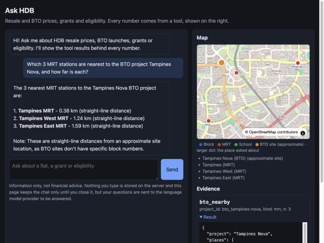
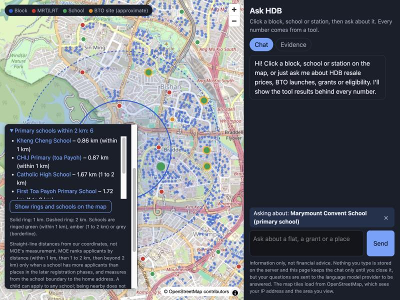
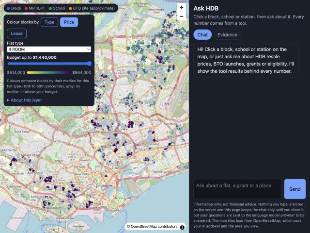
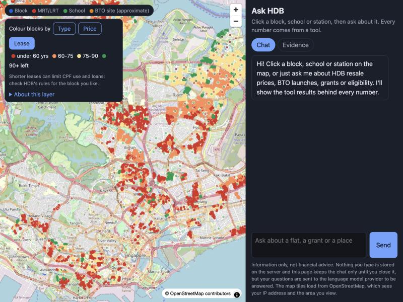

# Ask HDB

An agent that helps you find HDB resale flats you are **eligible for**, can **afford**,
and that are **near what matters to you** (MRT, schools, parents).

> Status (2026-10-23): data tools, rules, the grounded agent, an eval bank (124 questions) and a map-first web app are built and run locally
> on a 9B model. Not deployed. See [docs/roadmap.md](docs/roadmap.md) and [docs/week6-plan.md](docs/week6-plan.md).

## The app

A map of every HDB block, MRT/LRT station, primary school and BTO site, with a chat beside it. Click a place and the chat knows what
"this block" means; ask, and the answer shows its tool results, sources and the places on the map.
The [3D view](docs/week7-3d.md) adds building heights, approximate block facing and illustrative sun geometry (no shade).

| Answers shown on the map | Primary schools within 2 km (1 km and 2 km rings) |
|---|---|
|  |  |

| Price layer (median for a flat type, budget slider) | Lease layer (years left) |
|---|---|
|  |  |

Run it: `LLM_TIMEOUT=420 uv run ask-hdb serve` then open http://localhost:8000, or `docker compose up --build` ([docs/docker.md](docs/docker.md)).
Prices and lease colours are descriptive only (not a valuation or a forecast). School distances are straight-line; MOE measures its own.

## The problem

Buying an HDB resale flat in Singapore is confusing:
- Eligibility and grant rules are a web of conditions spread over many pages.
- The resale portal filters by town and flat type only. It cannot answer
  "4-room within 1 km of an MRT, under $600k, that I can get a grant for".
- Many buyers pay an agent thousands of dollars partly to work this out.

## The question

Can an agent answer real home-buying questions where **every number and every
eligibility verdict is correct and traceable**, while still feeling like a helpful chat?

## Core rule

- **The LLM talks. Code decides.**
- Eligibility, grants, loan limits, prices and distances are computed in code.
- The LLM only asks follow-up questions, picks which tools to call, and explains results.
- Every number in an answer must come from a tool result. A checker enforces this.

## What it does

```
You:   We're a married couple, both citizens, earning $8,500 a month together.
       We want a 4-room near Tampines MRT, under $600k. What can we get?
Agent: [confirms your profile] -> [checks eligibility + grants in code]
       -> [searches recent resale prices] -> [measures distance to MRT]
       -> "You qualify for these grants: ... Recent 4-room sales within 1 km of
          Tampines MRT: median $X (N sales, last 12 months). Sources: ..."
```

## Bring your own model
Ask HDB ships no model and no API key. You run it with your own:
- **Local model (default):** any OpenAI-compatible server on your own machine, such as
  llama-server, Ollama or MLX on a Mac or a GPU PC. Nothing leaves your machine.
- **Your own API key:** OpenAI or Anthropic. A chat subscription (ChatGPT, Claude) does not
  include API access, so this uses a separate API key that you paste into `.env`.
- **iOS (idea, not built):** Apple's on-device model (Foundation Models, supports tool
  calling) or a small model downloaded to the phone. Small models call tools less reliably,
  so this needs the same tool-calling test as the desktop models.

## Terminal commands

Copy `.env.example` to `.env` and set `LLM_*` for your local server or API provider.
For a cloud provider, remove `LLM_BASE_URL` to use its default endpoint and set your API key.

```bash
uv sync
uv run ask-hdb ask "What are the recorded resale price statistics in TAMPINES?"
uv run ask-hdb chat
uv run python scripts/tool_call_check.py
uv run --no-sync ask-hdb routing
uv run --no-sync ask-hdb eval --condition agent
uv run --no-sync ask-hdb eval --condition llm-only
```

Chat shows each tool call and its result before the answer. Type `quit` to leave.
`ask-hdb routing` keeps the previous tool-call check and its week-two notes.
`ask-hdb eval` scores the frozen answer bank and saves JSON plus Markdown after each question.
Use `--only price --verbose --limit 2` for a small run. Held-out questions run only with
`--heldout`. Reports resume explicitly; existing completed results and errors are retained.
See [evaluation details](docs/eval.md) and [comparison status](docs/eval-results.md).

Rows 2-5 are the 72-question dev set (2026-10-22/23, two runs each so the spread is visible); the last row is the full 85-question dev set on the final code (3 failures: two persistent, one variance). One 9B local model (qwen3.5-9b-16k on a MacBook):

| Condition | Number | Verdict | Refusal | Grounding |
|---|---|---|---|---|
| LLM-only (week 3, 40 questions) | 0.0% | 10.0% | 0.0% | 0.0% |
| Single agent, run A | 94.1% | 100% | 85.7% | 100% |
| Single agent, run B | 96.1% | 92.9% | 85.7% | 100% |
| Agent plus "Is this right?" profile confirmation, run A | 94.1% | 100% | 85.7% | 100% |
| Agent plus "Is this right?" profile confirmation, run B | 94.1% | 92.9% | 100% | 100% |
| Single agent, final code, 85 questions (one run, 2026-10-23) | 96.7% | 92.9% | 100% | 100% |

After the map questions were added, the map (9/9), distance (5/5) and refusal (11/11 after a scorer wording fix) kinds were re-run, not the whole set. The confirmation step is a safety feature, not an accuracy gain. Every round, regression and fix is in
[docs/eval-results.md](docs/eval-results.md). The 30 held-out questions that existed in week 5 were run once (24 of 30) and not tuned on; 38 are held out now.

## Stack (each picked to match current AI engineer job descriptions)

| Part | Choice |
|---|---|
| Language | Python, `uv`, `pytest`, `ruff` |
| Agent | LangGraph ReAct agent with 18 code tools (a supervisor graph is deferred) |
| Tools | Our own MCP server (resale search, price stats, eligibility, distances) |
| Model | Local model via llama-server (OpenAI-compatible). Swappable for a cloud model |
| RAG | not built (deferred) |
| Data | data.gov.sg resale prices, OneMap (geocoding, MRT, schools) |
| Tracing | Optional Langfuse (`uv sync --extra tracing`), off unless keys are set, text redacted by default |
| UI | FastAPI + plain-JS page, MapLibre 2D map (3D not built) |
| Deploy | Docker image and compose file, run locally as simulated hosting; no public host yet |

## Docs

- [docs/proposal.md](docs/proposal.md): the plan, decisions, scope and risks.
- [docs/architecture.md](docs/architecture.md): how the parts fit together.
- [docs/week6-plan.md](docs/week6-plan.md): the web app plan, re-scope and status.
- [docs/docker.md](docs/docker.md): running the image.
- [docs/eval.md](docs/eval.md): how we measure "correct".
- [docs/roadmap.md](docs/roadmap.md): weeks, tasks and exit checks.
- [docs/research.md](docs/research.md): what we found before starting, with sources.

## Disclaimer

This is a portfolio project, not financial or legal advice.
Always confirm eligibility and grants with HDB before you buy.

## License

MIT
