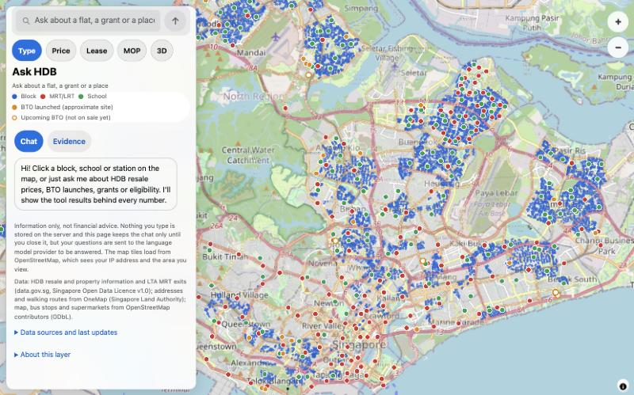
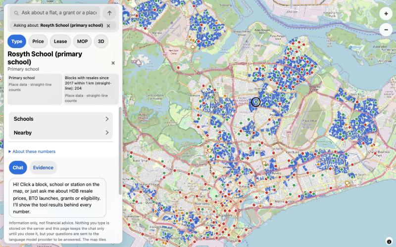

# Ask HDB

**Find an HDB flat you can buy, afford and live near, then check every number.**
A map of Singapore's HDB blocks with a chat beside it. Ask about prices, grants, eligibility and BTO launches, and see the data behind each answer.

**[Try the live demo](https://soba101.github.io/ask-hdb/)** (map, layers, 3D and walking routes work; chat is paused on the demo)



## Why it exists

Buying an HDB resale flat means reading eligibility and grant rules spread over many pages.
The official portal filters by town and flat type only, so it cannot answer "a 4-room near an MRT, under $600k, that I can get a grant for".
Many buyers pay an agent thousands of dollars partly to work this out. This project tries to do that work in the open, with answers you can check.

## What you can do

- **Ask in plain words.** "We earn $8,500 a month and want a 4-room near Tampines MRT under $600k. What can we get?"
- **See the evidence.** Each answer shows the tool results and sources it used, and puts the places on the map.
- **Click anything.** Pick a block, school or station and the chat knows what "this one" means.
- **Colour the map.** Blocks by flat type, median price (with a budget slider), remaining lease or MOP status.
- **Check what is nearby.** The three nearest supermarkets, MRT stations and bus stops, and a walking route with steps and a time.
- **Look at BTO.** Launched and upcoming sites, including Tengah, with an honest "not on sale yet" for the ones that are not.
- **Tilt to 3D.** Building heights, block facing and ground shadows for a chosen date and time.
- **Works on a phone.** The chat and the place card live in a bottom sheet.



## How it works

The model only chats and chooses which tool to call. Code does every number: eligibility, grants, loan limits, prices and distances.
A checker compares each number in an answer with the tool results. If a number has no source, the answer is rewritten.
If the rules cannot decide (for example, a detail is missing), the app asks for that detail and does not guess a verdict.

```
You:   We're a married couple, both citizens, earning $8,500 a month together.
       We want a 4-room near Tampines MRT, under $600k. What can we get?
Agent: [confirms your profile] -> [checks eligibility and grants in code]
       -> [searches recent resale prices] -> [measures distance to MRT]
       -> "You qualify for these grants: ... Recent 4-room sales within 1 km of
          Tampines MRT: median $X (N sales, last 12 months). Sources: ..."
```

## How well it works

An 85-question dev set (prices, eligibility, grants, BTO, distances, refusals), scored by code against a frozen answer bank.
Latest run (30 October 2026, one 9B model on a Mac): **82 of 85 passed**, 95% numbers right, 100% verdicts, 100% refusals,
and **100% of numbers traced to a tool result**. The same questions with no tools score 0% on numbers.
Three questions still fail. Every round, regression and fix is in [docs/eval-results.md](docs/eval-results.md). 38 more questions are held out.

## Quick start

```bash
git clone https://github.com/Soba101/ask-hdb && cd ask-hdb
cp .env.example .env        # add a model (local or your own API key)
uv sync
# build the data once: see docs/setup.md
uv run ask-hdb serve        # http://localhost:8000
```

Ask HDB ships no model and no API key. Use a local model (Ollama, llama-server, MLX) or your own key. Full steps, settings and the Docker route: [docs/setup.md](docs/setup.md).

## Built with

Python 3.12, FastAPI, LangGraph (agent loop) with 18 code tools, an MCP server around the same tools, MapLibre GL (2D and 3D) with a plain JavaScript page, Docker.
Data from data.gov.sg, OneMap and OpenStreetMap. Optional Langfuse tracing.

## Docs

- [Setup](docs/setup.md) and [Docker](docs/docker.md): run it, settings, build the data.
- [Architecture](docs/architecture.md): how the parts fit together.
- [Evaluation](docs/eval.md) and [results](docs/eval-results.md): how "correct" is measured.
- [Proposal](docs/proposal.md), [roadmap](docs/roadmap.md) and [research](docs/research.md): the plan and what came first.
- [3D and sun](docs/week7-3d.md), [nearby places and routes](docs/week8-amenity-plan.md), [routing test](docs/routing-ab.md), [hosting](docs/hosting-plan.md), [security](docs/security.md).

## Data credits

HDB resale and property information and LTA MRT exits from data.gov.sg (Singapore Open Data Licence v1.0);
addresses and walking routes from OneMap (Singapore Land Authority); map tiles, bus stops and supermarkets from OpenStreetMap contributors (ODbL).

## Disclaimer

This is a portfolio project, not financial or legal advice. Prices, lease and MOP colours describe the past and are not a valuation or a forecast.
Always confirm eligibility and grants with HDB before you buy.

## License

MIT
